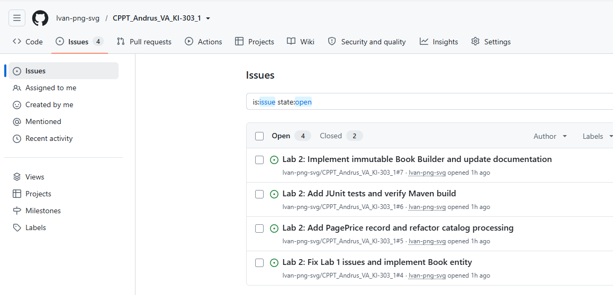
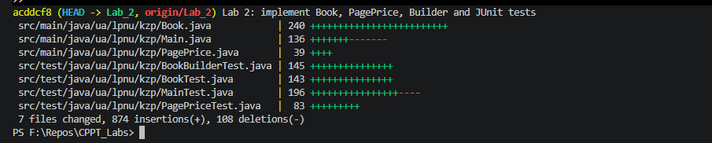
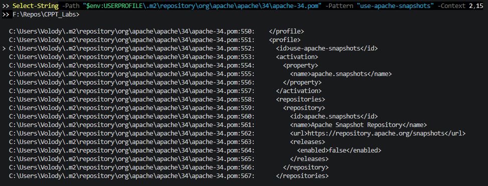
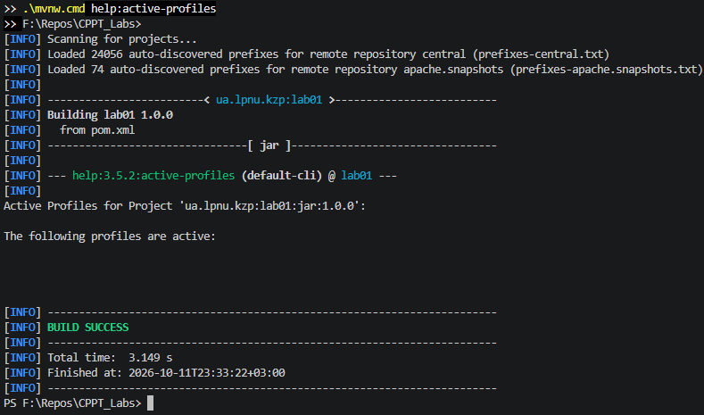
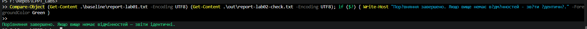
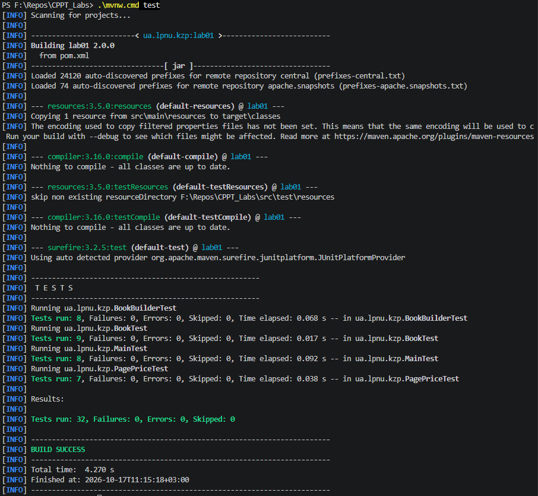
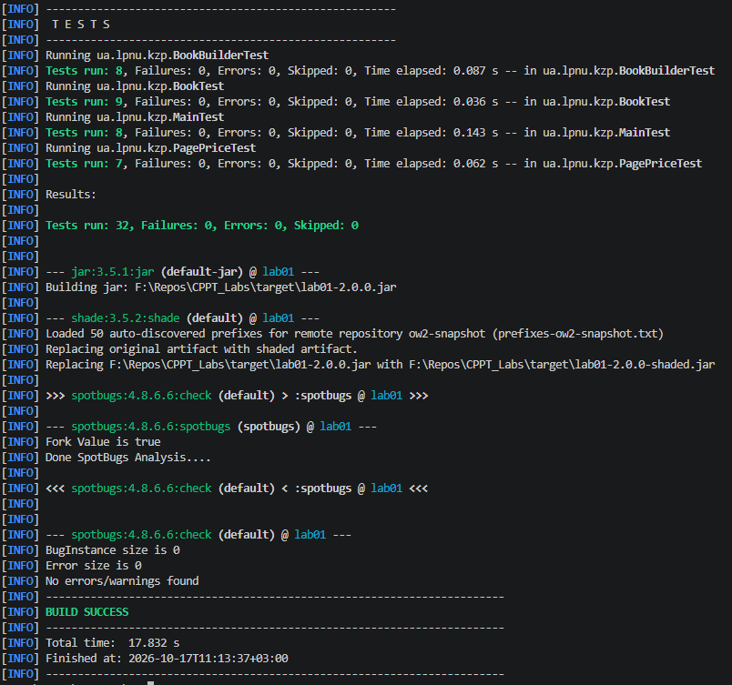

# ЗВІТ З ЛАБОРАТОРНОЇ РОБОТИ № 2

з дисципліни «Кросплатформні засоби програмування»

**Тема:** Рефакторинг Java-проєкту, об'єктно-орієнтована модель даних та автоматизоване тестування

**Варіант 1 — «Каталог книжок»**

**Виконав:** ст. гр. КІ-303 Андрус В.О.  
**Перевірив:** Олексів М.В.

**Львів — 2026**

---

## 1. Тема, номер і варіант

- **Дисципліна:** Кросплатформні засоби програмування.
- **Номер лабораторної роботи:** 2.
- **Варіант:** 1.
- **Предметна область:** Каталог книжок.
- **Мова програмування:** Java 21.
- **Система збирання:** Maven.
- **Операційна система локальної розробки:** Windows.
- **Гілка розробки:** `Lab_2`; актуальні зміни об’єднано з `main`.

## 2. Мета роботи

Метою лабораторної роботи є вдосконалення Java-проєкту, розробленого під час лабораторної роботи №1, шляхом застосування об'єктно-орієнтованого підходу, використання незмінних об'єктів, Java `record`, рефакторингу обробки даних, автоматизованого тестування та статичного аналізу.

Окремим завданням є виправлення зауважень до лабораторної роботи №1 та перевірка збереження попередньої функціональності.

## 3. Постановка задачі

Для варіанта №1 необхідно продовжити розробку програми «Каталог книжок», яка обробляє CSV-записи формату:

```text
title;author;pages;price
```

Потрібно забезпечити:

1. Представлення книжки окремим класом `Book`.
2. Розбір CSV-записів через `Book.fromCsv()`.
3. Зберігання коректних книжок у `List<Book>`.
4. Використання Java `record PagePrice`.
5. Формування статистики каталогу та повідомлень про помилки.
6. Виправлення трьох зауважень до лабораторної роботи №1.
7. Автоматизоване тестування через JUnit 5.
8. Статичний аналіз через SpotBugs.
9. Додаткову реалізацію шаблону Builder для класу `Book`.
10. Документування результатів у Git і GitHub.

## 4. Організація роботи в Git

Розробку лабораторної роботи №2 виконано в окремій гілці:

```text
Lab_2
```

Для збереження результатів лабораторної роботи №1 використано гілку:

```text
Lab_1
```

Початкові контрольні файли лабораторної роботи №1 збережено за шляхами:

```text
baseline/input-lab01.csv
baseline/report-lab01.txt
```

Під час виконання лабораторної роботи №2 створено GitHub Issues:

- **#4** — `Lab 2: Fix Lab 1 issues and implement Book entity`.
- **#5** — `Lab 2: Add PagePrice record and refactor catalog processing`.
- **#6** — `Lab 2: Add JUnit tests and verify Maven build`.
- **#7** — `Lab 2: Implement immutable Book Builder and update documentation`.

Реалізацію та тести збережено комітом:

```text
acddcf8 — Lab 2: implement Book, PagePrice, Builder and JUnit tests
```

Коміт завантажено до віддаленої гілки `origin/Lab_2`. Після завершення лабораторної зміни об’єднано з `main`, а Issues #4–#7 закрито. Додаткові зауваження до коду виправлено в гілці `fix/lab2-review` (коміт `656e8b7`); відповідний Pull Request #11 також об’єднано з `main`.

**Рисунок 1 — GitHub Issues лабораторної роботи №2.**



**Рисунок 2 — Коміт і завантаження змін у гілку Lab_2.**



## 5. Реалізація програми

### 5.1. Клас Book

Створено незмінний клас `Book` із полями:

```java
private final String title;
private final String author;
private final int pages;
private final double price;
```

Клас містить конструктор із перевіркою вхідних даних, методи доступу до полів, `toString()` і статичний метод `fromCsv()`.

Відкриті сеттери відсутні. Після створення об'єкта його стан не можна змінити через публічний інтерфейс.

Метод `Book.fromCsv()` перетворює текстовий рядок на об'єкт книжки та повідомляє про некоректні дані через `IllegalArgumentException`.

### 5.2. Record PagePrice

Створено Java `record` для представлення кількості сторінок і ціни:

```java
public record PagePrice(int pages, double price)
```

Компоненти `pages` та `price` перевіряються під час створення об'єкта.

Java автоматично надає методи `pages()`, `price()`, `equals()`, `hashCode()` і `toString()`.

### 5.3. Рефакторинг Main

У класі `Main` реалізовано обробку каталогу з використанням об'єктів `Book`.

Коректні записи зберігаються в `List<Book>`. Для формування статистики використовується модель даних `PagePrice`.

Програма визначає:

- кількість коректних записів;
- кількість некоректних записів;
- середню кількість сторінок;
- найдорожчу книжку;
- сумарну вартість каталогу;
- перелік помилок із номерами рядків.

Збережено підтримку аргументів `--help`, `--version`, `--input` і `--output`.

Для читання та запису файлів використовується UTF-8.

### 5.4. Реалізація Book.Builder

Як додаткове завдання реалізовано вкладений клас `Book.Builder`.

Приклад використання:

```java
Book book = Book.builder()
        .title("Кобзар")
        .author("Тарас Шевченко")
        .pages(720)
        .price(450.00)
        .build();
```

Метод `build()` викликає конструктор `Book`, тому правила валідації однакові для обох способів створення об’єкта. Поле ціни в Builder є обов’язковим: без виклику `.price(...)` метод `build()` генерує `IllegalArgumentException`, тоді як явно задана ціна `0.0` допустима. Це перевірено тестом `testBuilderRejectsMissingPrice()`.

Повторне використання Builder не змінює раніше створених книжок.

## 6. Виправлення зауважень до лабораторної роботи №1

### 6.1. Некоректні значення NaN та Infinity

**Проблема.** Перевірка `price < 0` не забезпечувала відхилення всіх нескінченних та невизначених значень типу `double`.

**Виправлення.** Використано перевірку:

```java
Double.isFinite(price)
```

Тепер `NaN`, `Infinity` та `-Infinity` відхиляються.

**Практична перевірка.** Для тестового CSV із трьома некоректними цінами та однією коректною книжкою отримано:

```text
Коректних записів: 1
Некоректних записів: 3
```

### 6.2. Переповнення під час підсумовування сторінок

**Проблема.** У лабораторній роботі №1 для загальної кількості сторінок використовувався тип `int`.

**Виправлення.** Для накопичення суми сторінок використано тип `long`.

**Практична перевірка.** Оброблено дві книжки по 2 000 000 000 сторінок.

Отримано:

```text
Коректних записів: 2
Некоректних записів: 0
Середня кількість сторінок: 2000000000.00
```

Результат підтверджує правильне обчислення середнього в перевіреному сценарії.

### 6.3. Дослідження apache.snapshots та ow2-snapshot

**Проблема.** У виводі Maven з'являлися назви репозиторіїв `apache.snapshots` і `ow2-snapshot`, хоча вони не були явно оголошені у файлі `pom.xml` проєкту.

Для дослідження використано:

- `help:effective-pom`;
- `help:effective-settings`;
- `help:active-profiles`;
- діагностичний журнал Maven із параметром `-X`;
- перевірку POM-файлів у локальному кеші Maven;
- перевірку локальних метаданих автоматичного визначення префіксів.

У перевірених Effective POM та Effective Settings цих назв не знайдено.

Команда `help:active-profiles` не показала активних профілів основного проєкту.

У батьківських POM-файлах Apache Maven знайдено оголошення snapshot-репозиторіїв. Зокрема, `apache-34.pom` містить профіль `use-apache-snapshots`, активація якого пов'язана з властивістю `apache.snapshots`.

У журналі Maven виявлено звернення до локальних метаданих:

```text
prefixes-apache.snapshots.txt
```

Під час роботи Maven Shade Plugin також спостерігалося повідомлення про:

```text
prefixes-ow2-snapshot.txt
```

**Висновок.** Згадки цих репозиторіїв пов'язані з конфігурацією та роботою Maven-плагінів і їхніх залежностей, а не з явним оголошенням у `pom.xml` проєкту. Точний ланцюжок успадкування конфігурації для конкретного запуску остаточно не встановлено.

**Рисунок 3 — Дослідження snapshot-репозиторіїв Maven.**



**Рисунок 4 — Перевірка активних профілів Maven.**



## 7. Перевірка сумісності з лабораторною роботою №1

Після рефакторингу програму запущено з контрольним файлом:

```text
baseline/input-lab01.csv
```

Результат порівняно з:

```text
baseline/report-lab01.txt
```

Для порівняння використано PowerShell:

```powershell
Compare-Object (Get-Content .\baseline\report-lab01.txt -Encoding UTF8) (Get-Content .\out\report-lab02-check.txt -Encoding UTF8)
```

Команда не вивела відмінностей.

Отже, для контрольного набору даних формат і вміст звіту після рефакторингу залишилися сумісними з результатом лабораторної роботи №1.

**Рисунок 5 — Порівняння контрольних звітів лабораторних робіт №1 і №2.**



## 8. Автоматизоване тестування JUnit 5

Для перевірки програми використано чотири тестові класи.

| Тестовий клас | Кількість тестів |
|---|---:|
| `MainTest` | 8 |
| `BookTest` | 9 |
| `PagePriceTest` | 7 |
| `BookBuilderTest` | 8 |
| **Разом** | **32** |

Тести охоплюють:

- правильну обробку CSV;
- некоректні та порожні записи;
- українські символи;
- обчислення статистики;
- відхилення `NaN` і нескінченних цін;
- підсумовування великої кількості сторінок;
- конструктор і методи класу `Book`;
- розбір CSV через `Book.fromCsv()`;
- перевірку `PagePrice`;
- створення об'єктів через Builder;
- незалежність об'єктів, створених повторним використанням Builder.

Для запуску використано команду:

```powershell
.\mvnw.cmd test
```

Отриманий результат:

```text
Tests run: 32, Failures: 0, Errors: 0, Skipped: 0
BUILD SUCCESS
```

**Рисунок 6 — Результат виконання JUnit-тестів (знімок екрана до додавання 32-го тесту).**



## 9. Статичний аналіз SpotBugs

У `pom.xml` налаштовано `spotbugs-maven-plugin` версії `4.8.6.6`.

Повну перевірку виконано командою:

```powershell
.\mvnw.cmd clean verify
```

Під час виконання Maven:

1. Скомпілював Java-код.
2. Запустив 32 JUnit-тести (після додавання тесту відсутньої ціни в Builder).
3. Створив JAR-файл.
4. Виконав Maven Shade Plugin.
5. Запустив SpotBugs.

Отримано:

```text
BugInstance size is 0
Error size is 0
No errors/warnings found
BUILD SUCCESS
```

Отже, під час виконаної перевірки SpotBugs не виявив зауважень.

**Рисунок 7 — Успішне виконання SpotBugs і Maven Verify.**



## 10. Збірка та запуск програми

Для збірки використовується Maven Wrapper:

```powershell
.\mvnw.cmd clean verify
```

Після успішної збірки сформовано виконуваний JAR:

```text
target/lab01-2.0.0-shaded.jar
```

Запуск програми:

```powershell
java -jar .\target\lab01-2.0.0-shaded.jar --input .\data\input.csv --output .\out\report.txt
```

Назва артефакту `lab01` залишена для сумісності з наявною конфігурацією Maven-проєкту.

## 10.1. Автоматична перевірка GitHub Actions CI

У файлі `.github/workflows/ci.yml` налаштовано автоматичну перевірку для `push` і Pull Request до гілки `main`.

CI виконує Maven Wrapper `verify` з Java 21 (Temurin) на Ubuntu, Windows і macOS. Під час перевірки запускаються JUnit-тести, збірка JAR і SpotBugs. Номер запуску GitHub Actions передається у властивість Maven `buildNumber`, а зібрані JAR-файли зберігаються як артефакти workflow.

## 11. Документація та академічна доброчесність

Для документування проєкту використовуються:

- `README.md` — опис проєкту та інструкції із запуску;
- `REPORT.md` — звіт лабораторної роботи №2 у поточній гілці;
- звіт лабораторної роботи №1 — у гілці `Lab_1`;
- Javadoc-коментарі у вихідному коді.

Під час виконання лабораторної роботи використовувався ChatGPT як допоміжний інструмент для пояснення команд Git і Maven, аналізу помилок, підготовки варіантів реалізації, тестових сценаріїв та документації.

Запропоновані зміни перевірялися локально за допомогою Maven, JUnit 5, SpotBugs і контрольних вхідних даних.

## 12. Висновки

У результаті виконання лабораторної роботи №2 вдосконалено Java-програму «Каталог книжок» відповідно до варіанта №1.

Реалізовано незмінний клас `Book`, Java `record PagePrice`, розбір CSV-записів через `Book.fromCsv()`, використання `List<Book>` і шаблон Builder.

Виправлено перевірку нескінченних та невизначених цін, усунуто переповнення `int` у перевіреному сценарії підсумовування сторінок і досліджено появу snapshot-репозиторіїв у Maven.

Збережено сумісність результатів програми з лабораторною роботою №1 для контрольного набору даних.

Успішно виконано **32 JUnit-тести**, а статичний аналіз SpotBugs завершився без зауважень. Повна збірка `clean verify` отримала статус **BUILD SUCCESS**.

Результати реалізації збережено в Git-гілці `Lab_2`, завантажено на GitHub та об’єднано з `main`. Додаткові виправлення об’єднано через Pull Request #11.
