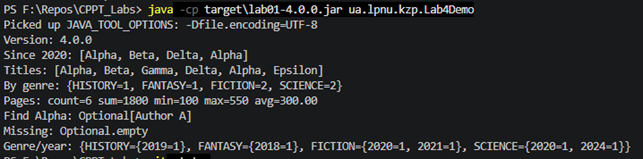
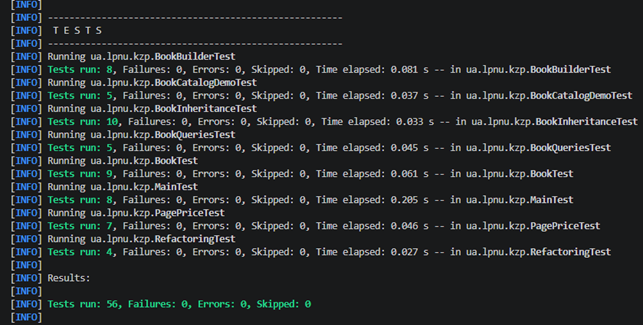
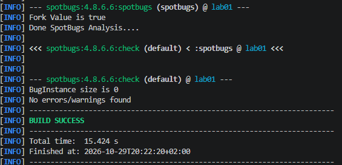
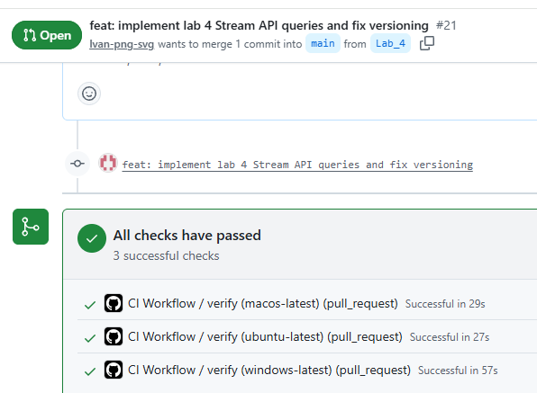
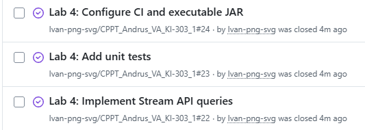
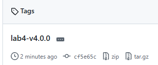

# ЗВІТ З ЛАБОРАТОРНОЇ РОБОТИ № 4

з дисципліни «Кросплатформні засоби програмування»

**Тема:** Обробка колекцій за допомогою Java Stream API  
**Варіант:** 1 — «Бібліотека» (каталог книжок)  
**Виконав:** ст. гр. КІ-303 Андрус В.О.  
**Перевірив:** Олексів М.В.  
**Львів — 2026**

## 1. Мета роботи

Опанувати конвеєри Stream API у Java 21 для фільтрації, перетворення, групування, статистики, сортування й пошуку даних; використати `Optional`, перевірити крайові випадки та зберегти сумісність із попередніми лабораторними роботами.

## 2. Середовище та вихідний проєкт

- Java 21, Maven і Maven Wrapper, JUnit 5, SpotBugs.
- Пакет: `ua.lpnu.kzp`.
- Гілка розробки: `Lab_4`; ціль Pull Request: `main`.
- Локальна перевірка виконана в Windows PowerShell.
- Основа — каталог книжок із лабораторних №1–3: `Book`, `PrintedBook`, `ElectronicBook`, `Main`, обробка CSV та текстовий звіт.

## 3. Постановка задачі

Для набору книжок реалізувати методи Stream API: відбір за роком публікації (від 2020 включно), отримання назв, підрахунок книжок за жанрами, статистику сторінок, топ-5 за сторінками зі вторинним сортуванням за назвою, пошук за назвою з `Optional`. Додаткове завдання — вкладене групування за жанром і роком.

## 4. Реалізація

Додано `BookGenre` та необов'язкові для попереднього CSV метадані `publicationYear` і жанр у `Book`. Старий формат `title;author;pages;price` не змінено; для старих записів передбачені значення року `0` та жанру `UNSPECIFIED`.

Запити зосереджено в `BookQueries`, демонстраційний набір — у `Lab4Demo`. Використано `filter`, `map`, `Collectors.groupingBy`, `Collectors.counting`, `Collectors.summarizingInt`, `sorted`, `limit` і `findFirst`. Для топу порівняння сторінок розгортається за спаданням **до** додавання `thenComparing` за назвою, тому назви з однаковою кількістю сторінок сортуються за зростанням.

`Optional` дозволяє безпечно представити відсутність результату. Запити не повинні змінювати вхідну колекцію.

## 5. Контрольні дані

| Назва | Сторінок | Рік | Жанр |
|---|---:|---:|---|
| Alpha | 400 | 2020 | SCIENCE |
| Beta | 400 | 2021 | FICTION |
| Gamma | 550 | 2019 | HISTORY |
| Delta | 200 | 2024 | SCIENCE |
| Alpha | 150 | 2020 | FICTION |
| Epsilon | 100 | 2018 | FANTASY |

Набір перевіряє включення граничного 2020 року, однакову кількість сторінок у `Alpha` та `Beta`, повтор назви `Alpha` і відсутній результат пошуку.

## 6. Результати запуску `Lab4Demo`

```text
Version: 4.0.0
Since 2020: [Alpha, Beta, Delta, Alpha]
Titles: [Alpha, Beta, Gamma, Delta, Alpha, Epsilon]
By genre: {HISTORY=1, FANTASY=1, FICTION=2, SCIENCE=2}
Pages: count=6 sum=1800 min=100 max=550 avg=300.00
Top 5: [Gamma, Alpha, Beta, Delta, Alpha]
Find Alpha: Optional[Author A]
Missing: Optional.empty
Genre/year: {HISTORY={2019=1}, FANTASY={2018=1}, FICTION={2020=1, 2021=1}, SCIENCE={2020=1, 2024=1}}
```

Сума сторінок дорівнює 1800, середнє — `1800 / 6 = 300.00`. У топі `Alpha` (400 сторінок) розташовано перед `Beta` (400 сторінок), оскільки назва є другим критерієм. Порядок ключів у звичайній `Map` не є обов'язковою частиною результату.

**Рисунок 1 — Демонстрація запитів Stream API.**



## 7. Порівняння циклової обробки та Stream API

| Операція | Цикловий підхід | Реалізація Stream API |
|---|---|---|
| Відбір книжок від 2020 року | Перебір записів і перевірка року через `if` | `filter(book -> book.getPublicationYear() >= 2020)` |
| Отримання назв | Перебір і додавання назви до списку | `map` і `toList` |
| Кількість книжок за жанрами | Накопичення лічильників у `Map` | `groupingBy` разом із `counting` |
| Статистика сторінок | Окреме обчислення кількості, суми, мінімуму, максимуму та середнього | `summarizingInt` |
| Топ-5 за сторінками та назвою | Сортування за двома критеріями й вибір перших п'яти | `sorted` з `reversed` і `thenComparing`, далі `limit(5)` |
| Пошук за назвою | Перебір до першого збігу | `filter` і `findFirst`, результат `Optional` |

**Порівняння результатів.** На контрольному наборі з шести книжок потоки повертають чотири книжки від 2020 року, шість назв, розподіл за жанрами `HISTORY=1`, `FANTASY=1`, `FICTION=2`, `SCIENCE=2` та статистику сторінок: кількість `6`, сума `1800`, мінімум `100`, максимум `550`, середнє `300.00`. Топ-5: `Gamma`, `Alpha`, `Beta`, `Delta`, `Alpha`. Для назви `Alpha` повертається перший запис, для відсутньої назви — `Optional.empty`. Ці результати узгоджуються з відповідними цикловими правилами відбору, підрахунку та впорядкування; окремого автоматизованого тесту, що порівнює дві реалізації на одному наборі, у наданих доказах немає.

**Збереження попередньої поведінки.** Запуск старого CSV-звіту після змін показав попередні контрольні показники: п'ять коректних і п'ять некоректних записів, середнє `344.80`, найдорожча книжка «Кобзар» (`450.00 грн`), загальна вартість `1540.00 грн`. Побайтове порівняння з файлом попереднього звіту не виконувалося.

## 8. Тести та крайові випадки

У `BookQueriesTest` перевіряються запити Stream API та крайові випадки: порожній список, межа року 2020, повтори назв, відсутній пошук, однакова кількість сторінок, а також параметр `N` для топу (`N < 0`, `N = 0`, `N > size`). Збережено тести попередніх лабораторних.

**Фактичний результат локальної команди `clean verify`:** 52 тести, 0 failures, 0 errors, 0 skipped; `BUILD SUCCESS`.

**Рисунок 2 — Результати виконання JUnit-тестів.**



## 9. Збірка, версія та зворотна сумісність

```powershell
.\mvnw.cmd clean verify
java -jar target\lab01-4.0.0.jar --version
java -jar target\lab01-4.0.0.jar
java -cp target\lab01-4.0.0.jar ua.lpnu.kzp.Lab4Demo
```

`--version` виводить `4.0.0`. Версія визначається у `pom.xml`, а `VersionInfo` читає Maven-фільтрований ресурс `version.properties`; у `Main` немає жорстко прописаного номера версії.

Основна програма продовжує обробляти попередній CSV. Підтверджено 5 коректних і 5 некоректних записів, середню кількість сторінок `344.80`, найдорожчу книжку «Кобзар» (`450.00 грн`) та сумарну вартість `1540.00 грн`. Для правильного відображення українських символів у Windows PowerShell використано:

```powershell
chcp 65001
$env:JAVA_TOOL_OPTIONS="-Dfile.encoding=UTF-8"
```

Побайтове порівняння з контрольним файлом окремо не підтверджене.

## 10. SpotBugs та CI

У локальному `verify` SpotBugs завершився без невиключених зауважень (`BugInstance size is 0`, `Error size is 0`). При цьому `spotbugs-exclude.xml` містить цільове виключення попереджень `CT_CONSTRUCTOR_THROW`; це **не є доказом усунення їх першопричини**.

Для Pull Request `Lab_4` → `main` користувач підтвердив три успішні перевірки GitHub Actions. Наявний workflow проєкту передбачає матрицю Ubuntu, Windows і macOS та збереження JAR-артефактів. Конкретний запуск CI і наявність артефактів потрібно додатково звірити на GitHub; їх не слід вважати підтвердженими лише за кількістю зелених перевірок.

**Рисунок 3 — Результат статичного аналізу SpotBugs.**



**Рисунок 4 — GitHub Actions: перевірки CI.**



## 11. GitHub та версіонування

Код лабораторної №4 збережено в окремій гілці `Lab_4` і завантажено на GitHub. Pull Request до `main` створено, три перевірки пройдено. Скріншот GitHub Issues додано; їхні номери й статуси можна перевірити на GitHub. Pull Request із змінами лабораторної №4 та документації об’єднано з `main`: локальна гілка `main` синхронізована з `origin/main`, а повторна команда `mvnw.cmd clean verify` завершилася `BUILD SUCCESS` (52 тести, 0 помилок SpotBugs). Скріншот Git-тегу наведено нижче; фактичну назву тегу потрібно звірити зі сторінкою Tags.

**Рисунок 5 — GitHub Issues лабораторної №4.**



**Рисунок 6 — Pull Request лабораторної №4.**


### Git-тег лабораторної роботи №4

Для фіксації завершеної версії лабораторної роботи №4
створено Git-тег лабораторної №4 (точну назву показано на скріншоті).



## 12. Контрольні питання (усі 20 з методички ЛР4)

**1. Чим потік відрізняється від колекції?** Колекція зберігає дані, Stream описує одноразове обчислення над джерелом і не зберігає елементи.

**2. Які частини має типовий конвеєр Stream API?** Джерело, нуль або більше проміжних операцій та кінцева операція.

**3. Чому проміжні операції називають лінивими?** Вони не виконують обхід джерела до запуску кінцевої операції.

**4. Що робить filter і який тип має його предикат?** filter залишає елементи, для яких Predicate<T> повертає boolean true.

**5. Чим map відрізняється від mapToDouble?** map повертає Stream<R>, а mapToDouble створює примітивний DoubleStream без пакування double.

**6. Для чого застосовується distinct і від чого залежить його результат?** Видаляє повтори; для об’єктів використовує equals і hashCode.

**7. Чому порядок sorted().limit(N) відрізняється від limit(N).sorted()?** У першому випадку сортується вся вибірка перед відсіканням, у другому — лише перші N вхідних елементів.

**8. Яку роль виконує кінцева операція?** Запускає конвеєр і створює результат або побічний ефект; після неї потік повторно не використовують.

**9. Коли застосовується Collectors.joining?** Коли рядкові елементи потрібно об’єднати в один рядок з роздільником, префіксом або суфіксом.

**10. Як groupingBy будує карту груп?** Застосовує функцію класифікації до кожного елемента і збирає значення за ключами.

**11. Як отримати суму в кожній групі через downstream collector?** Передати groupingBy(ключ, Collectors.summingInt(...)) або summingDouble(...).

**12. Які показники містить DoubleSummaryStatistics?** Кількість, суму, мінімум, максимум і середнє.

**13. Які значення має статистика для порожнього потоку?** count=0, sum=0, average=0, min=+Infinity, max=-Infinity; у звіті це треба пояснити.

**14. Як утворюється складений компаратор?** Comparator.comparing(...) або comparingInt(...), після чого thenComparing(...) для другого ключа.

**15. Чому reversed() потрібно застосовувати до окремого ключа до thenComparing?** Інакше reversed() змінить напрямок порівняння всього складеного компаратора, включно з другим ключем.

**16. Яку проблему розв’язує Optional у методі пошуку?** Явно представляє наявний або відсутній результат замість повернення null.

**17. Чим відрізняються orElse, orElseThrow і ifPresent?** orElse повертає значення або запасне; orElseThrow кидає виняток за відсутності; ifPresent виконує дію лише за наявності.

**18. Чому накопичення результату через зовнішній змінний список у forEach небажане?** Це побічний ефект, що ускладнює читання і створює ризик гонок у паралельних потоках; краще collect або toList.

**19. Які властивості мають бути перевірені під час рефакторингу циклу на потік?** Порядок, значення і статистику, дублікати, порожній вхід, межі N, відсутній пошук, незмінність джерела та попередні тести.

**20. За яких умов паралельний потік може бути виправданим?** На достатньо великому наборі, для незалежних операцій без спільного змінного стану, коли вимірювання показує перевагу.

## 13. Використання ШІ

ChatGPT застосовувався як допоміжний інструмент для обговорення реалізації Stream API, тестових сценаріїв, аналізу Maven/SpotBugs та редагування документації. Результати виконання й перевірки наведено за фактичними локальними запусками та повідомленням про статус GitHub Actions. Власний внесок студента та деталі захисту можна уточнити перед здачею.

## 14. Висновки

У лабораторній роботі №4 реалізовано основні операції Stream API та додаткове вкладене групування за жанром і роком. Успішно виконано демонстрацію, 52 JUnit-тести, локальну Maven-збірку, запуск JAR і перевірку версії `4.0.0`. Попередній сценарій CSV-звіту збережено. Зміни об’єднано з `main`; для повної документальної перевірки залишається звірити артефакти конкретного запуску CI та номери GitHub Issues.

## 15. Виправлення зауважень викладача (оновлена версія)

| Було | Стало |
|---|---|
| Обробка CLI в Main | `CommandLineOptions.parse` |
| CSV, статистика та звіт в Main | `CatalogReader`, `CatalogReport`, `CatalogApplication` |
| Цикл підсумовування в Main | `mapToLong().sum()`, `mapToDouble().sum()`, `max()` |
| Запити тільки у демонстрації | `CatalogApplication.query()` викликається у робочому `run()` |
| Підтипи без року і жанру | Нові конструктори з `publicationYear`, `BookGenre` |
| Неповні контрольні питання | Усі 20 відповідей у розділі 12 |
| Номер білда не доступний через API | `VersionInfo.buildNumber()` та `fullVersion()` |

Збережено чотириколонковий CSV і текстовий формат попереднього звіту. Для старих CSV-записів рік дорівнює 0, жанр — `UNSPECIFIED`; це означає, що фільтр «від 2020 року» для них порожній. Щоб перевіряти повноцінні запити ЛР4, використовуються об’єкти з роком і жанром.

**Перевірка:** у середовищі підготовки архіву Maven Wrapper не зміг завантажити Maven 3.10.0 через відсутність мережевого доступу. Тому нові тести, SpotBugs, JAR і віддалений CI не позначаються як перевірені. Для підтвердження виконати `mvnw.cmd clean verify` і `mvnw.cmd package` на Windows, а також перевірити GitHub Actions після push. GitHub Issues, PR і тег необхідно створити/оновити в репозиторії окремо.
