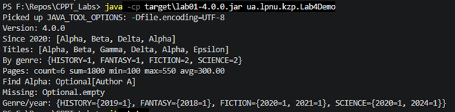
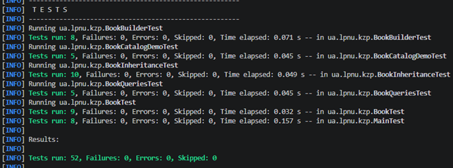
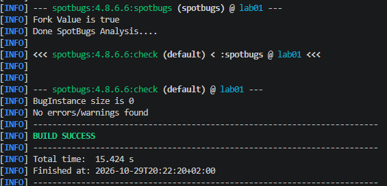
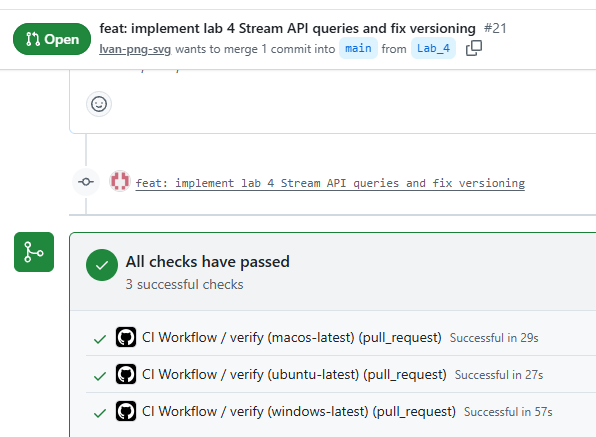
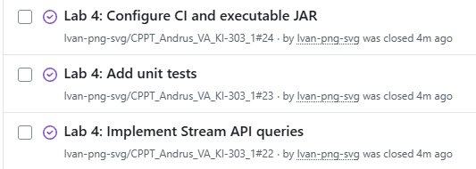
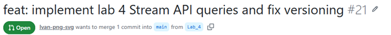

# ЗВІТ З ЛАБОРАТОРНОЇ РОБОТИ № 4

з дисципліни «Кросплатформні засоби програмування»

**Тема:** Обробка колекцій за допомогою Java Stream API  
**Варіант:** 1 — «Бібліотека» (каталог книжок)  
**Виконав:** ст. гр. КІ-303 Андрус В.О.  
**Перевірив:** Олексів М.В.  
**Львів — 2026**

## 1. Мета роботи

Опанувати конвеєри Stream API у Java 21 для фільтрації, перетворення, групування, статистики, сортування й пошуку даних; використати `Optional`, перевірити крайові випадки та зберегти сумісність із попередніми лабораторними роботами.

## 2. Середовище та вихідний проєкт

- Java 21, Maven і Maven Wrapper, JUnit 5, SpotBugs.
- Пакет: `ua.lpnu.kzp`.
- Гілка розробки: `Lab_4`; ціль Pull Request: `main`.
- Локальна перевірка виконана в Windows PowerShell.
- Основа — каталог книжок із лабораторних №1–3: `Book`, `PrintedBook`, `ElectronicBook`, `Main`, обробка CSV та текстовий звіт.

## 3. Постановка задачі

Для набору книжок реалізувати методи Stream API: відбір за роком публікації (від 2020 включно), отримання назв, підрахунок книжок за жанрами, статистику сторінок, топ-5 за сторінками зі вторинним сортуванням за назвою, пошук за назвою з `Optional`. Додаткове завдання — вкладене групування за жанром і роком.

## 4. Реалізація

Додано `BookGenre` та необов'язкові для попереднього CSV метадані `publicationYear` і жанр у `Book`. Старий формат `title;author;pages;price` не змінено; для старих записів передбачені значення року `0` та жанру `UNSPECIFIED`.

Запити зосереджено в `BookQueries`, демонстраційний набір — у `Lab4Demo`. Використано `filter`, `map`, `Collectors.groupingBy`, `Collectors.counting`, `Collectors.summarizingInt`, `sorted`, `limit` і `findFirst`. Для топу порівняння сторінок розгортається за спаданням **до** додавання `thenComparing` за назвою, тому назви з однаковою кількістю сторінок сортуються за зростанням.

`Optional` дозволяє безпечно представити відсутність результату. Запити не повинні змінювати вхідну колекцію.

## 5. Контрольні дані

| Назва | Сторінок | Рік | Жанр |
|---|---:|---:|---|
| Alpha | 400 | 2020 | SCIENCE |
| Beta | 400 | 2021 | FICTION |
| Gamma | 550 | 2019 | HISTORY |
| Delta | 200 | 2024 | SCIENCE |
| Alpha | 150 | 2020 | FICTION |
| Epsilon | 100 | 2018 | FANTASY |

Набір перевіряє включення граничного 2020 року, однакову кількість сторінок у `Alpha` та `Beta`, повтор назви `Alpha` і відсутній результат пошуку.

## 6. Результати запуску `Lab4Demo`

```text
Version: 4.0.0
Since 2020: [Alpha, Beta, Delta, Alpha]
Titles: [Alpha, Beta, Gamma, Delta, Alpha, Epsilon]
By genre: {HISTORY=1, FANTASY=1, FICTION=2, SCIENCE=2}
Pages: count=6 sum=1800 min=100 max=550 avg=300.00
Top 5: [Gamma, Alpha, Beta, Delta, Alpha]
Find Alpha: Optional[Author A]
Missing: Optional.empty
Genre/year: {HISTORY={2019=1}, FANTASY={2018=1}, FICTION={2020=1, 2021=1}, SCIENCE={2020=1, 2024=1}}
```

Сума сторінок дорівнює 1800, середнє — `1800 / 6 = 300.00`. У топі `Alpha` (400 сторінок) розташовано перед `Beta` (400 сторінок), оскільки назва є другим критерієм. Порядок ключів у звичайній `Map` не є обов'язковою частиною результату.

**Рисунок 1 — Демонстрація запитів Stream API.**



## 7. Тести та крайові випадки

У `BookQueriesTest` перевіряються запити Stream API та крайові випадки: порожній список, межа року 2020, повтори назв, відсутній пошук, однакова кількість сторінок, а також параметр `N` для топу (`N < 0`, `N = 0`, `N > size`). Збережено тести попередніх лабораторних.

**Фактичний результат локальної команди `clean verify`:** 52 тести, 0 failures, 0 errors, 0 skipped; `BUILD SUCCESS`.

**Рисунок 2 — Результати виконання JUnit-тестів.**



## 8. Збірка, версія та зворотна сумісність

```powershell
.\mvnw.cmd clean verify
java -jar target\lab01-4.0.0.jar --version
java -jar target\lab01-4.0.0.jar
java -cp target\lab01-4.0.0.jar ua.lpnu.kzp.Lab4Demo
```

`--version` виводить `4.0.0`. Версія визначається у `pom.xml`, а `VersionInfo` читає Maven-фільтрований ресурс `version.properties`; у `Main` немає жорстко прописаного номера версії.

Основна програма продовжує обробляти попередній CSV. Підтверджено 5 коректних і 5 некоректних записів, середню кількість сторінок `344.80`, найдорожчу книжку «Кобзар» (`450.00 грн`) та сумарну вартість `1540.00 грн`. Для правильного відображення українських символів у Windows PowerShell використано:

```powershell
chcp 65001
$env:JAVA_TOOL_OPTIONS="-Dfile.encoding=UTF-8"
```

Побайтове порівняння з контрольним файлом окремо не підтверджене.

## 9. SpotBugs та CI

У локальному `verify` SpotBugs завершився без невиключених зауважень (`BugInstance size is 0`, `Error size is 0`). При цьому `spotbugs-exclude.xml` містить цільове виключення попереджень `CT_CONSTRUCTOR_THROW`; це **не є доказом усунення їх першопричини**.

Для Pull Request `Lab_4` → `main` користувач підтвердив три успішні перевірки GitHub Actions. Наявний workflow проєкту передбачає матрицю Ubuntu, Windows і macOS та збереження JAR-артефактів. Конкретний запуск CI і наявність артефактів потрібно додатково звірити на GitHub; їх не слід вважати підтвердженими лише за кількістю зелених перевірок.

**Рисунок 3 — Результат статичного аналізу SpotBugs.**



**Рисунок 4 — GitHub Actions: перевірки CI.**



## 10. GitHub та версіонування

Код лабораторної №4 збережено в окремій гілці `Lab_4` і завантажено на GitHub. Pull Request до `main` створено, три перевірки пройдено. Скріншот GitHub Issues додано, але їхній статус і номери потрібно перевірити; злиття Pull Request та тег `v4.0.0` на момент підготовки цього звіту ще не підтверджені; після виконання слід додати фактичні номери Issues/PR та посилання на запуск CI.

**Рисунок 5 — GitHub Issues лабораторної №4.**



**Рисунок 6 — Pull Request лабораторної №4.**



**Рисунок 7 — Git-тег `v4.0.0`** буде додано після створення тегу та завантаження його на GitHub.

## 11. Контрольні питання

**Чим Stream відрізняється від колекції?** Колекція зберігає елементи, а Stream описує послідовність операцій їх обробки.

**Що роблять `filter` і `map`?** `filter` відбирає елементи за умовою, `map` перетворює кожен елемент.

**Для чого потрібен `groupingBy`?** Він групує елементи за ключем; у поєднанні з `counting` дає кількість елементів кожної групи.

**Навіщо `summarizingInt`?** Щоб за один збір отримати кількість, суму, мінімум, максимум і середнє числових значень.

**Чому `sorted` має стояти перед `limit`?** Інакше вибираються перші `N` елементів вхідного порядку, а не глобальний топ.

**Що дає `Optional`?** Явно представляє результат, який може бути відсутнім, без необхідності повертати `null`.

## 12. Використання ШІ

ChatGPT застосовувався як допоміжний інструмент для обговорення реалізації Stream API, тестових сценаріїв, аналізу Maven/SpotBugs та редагування документації. Результати виконання й перевірки наведено за фактичними локальними запусками та повідомленням про статус GitHub Actions. Власний внесок студента та деталі захисту можна уточнити перед здачею.

## 13. Висновки

У лабораторній роботі №4 реалізовано основні операції Stream API та додаткове вкладене групування за жанром і роком. Успішно виконано демонстрацію, 52 JUnit-тести, локальну Maven-збірку, запуск JAR і перевірку версії `4.0.0`. Попередній сценарій CSV-звіту збережено. Після остаточної перевірки артефактів CI та оформлення GitHub Issues, злиття PR і тегу документацію можна доповнити відповідними посиланнями.
