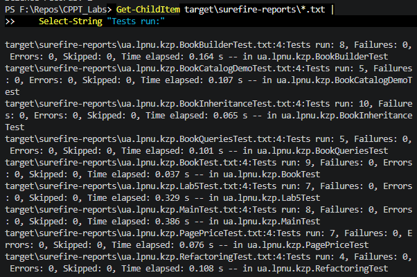
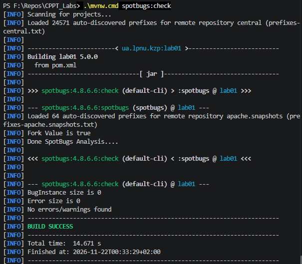
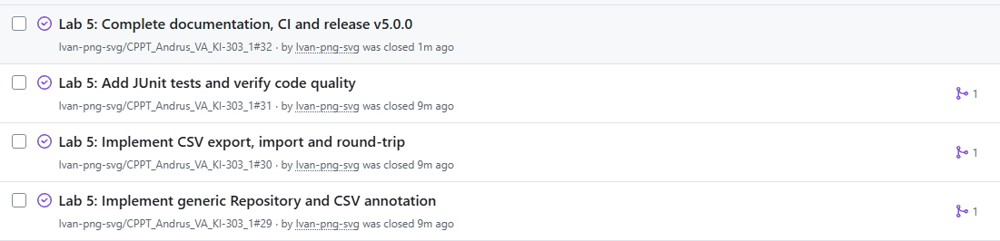
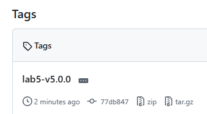

# ЗВІТ З ЛАБОРАТОРНОЇ РОБОТИ № 5

з дисципліни «Кросплатформні засоби програмування»

**Тема:** Узагальнення, анотації, рефлексія та робота з CSV у Java 21  
**Варіант:** 1 — «Бібліотека»  
**Виконав:** ст. гр. КІ-303 Андрус В.О.  
**Перевірив:** Олексів М.В.  
**Львів — 2026**

## 1. Мета роботи

Навчитися створювати узагальнені класи (`generics`), застосовувати функціональні інтерфейси, власні анотації та Java Reflection API; реалізувати універсальний CSV-експорт і предметний імпорт з коректною обробкою помилок, перевірити round-trip і зберегти сумісність попередніх лабораторних.

## 2. Середовище виконання

- Java 21; Maven / Maven Wrapper; JUnit 5; SpotBugs 4.8.6.6.
- Група Maven: `ua.lpnu.kzp`; артефакт: `lab01`; версія: `5.0.0`.
- Пакет Java: `ua.lpnu.kzp`.
- Гілка: `Lab_5`; цільовий `main`.
- Локальна перевірка: Windows PowerShell.

## 3. Постановка задачі (варіант 1)

Реалізувати модель книжкового запису з назвою, автором, роком видання, кількістю сторінок та жанром. Створити узагальнений репозиторій для додавання, перегляду та пошуку записів. Описати поля CSV власною анотацією; засобами рефлексії сформувати CSV з детермінованим порядком колонок. Забезпечити імпорт, екранування спеціальних символів, UTF-8, власний перевірюваний виняток, тести та перевірку round-trip. Не порушити роботу лабораторних №1–4.

## 4. Структура реалізації

| Файл | Призначення |
|---|---|
| `BookRecord.java` | Незмінна модель книжкового запису та перетворення CSV-полів |
| `Repository.java` | Узагальнене сховище `Repository<T>` |
| `CsvColumn.java` | Анотація полів, доступна під час виконання |
| `CsvExporter.java` | Рефлексивний CSV-експорт |
| `CsvParser.java` | Парсер CSV-документа |
| `BookRecordCsv.java` | Імпорт і перевірка записів предметної області |
| `DataStorageException.java` | Перевірюваний виняток з першопричиною |
| `Lab5Demo.java` | Демонстрація експорту, імпорту та пошуку |
| `Lab5Test.java` | Сім JUnit-тестів ЛР5 |

Модель `BookRecord` містить `title: String`, `author: String`, `year: int`, `pages: int`, `genre: BookGenre`. Наявний `BookGenre` повторно використовується з ЛР4.

## 5. Узагальнений репозиторій

`Repository<T>` не залежить від типу предметних даних. Метод `add(T)` додає елемент; `all()` повертає незмінний знімок колекції; `find(Predicate<? super T>)` повертає елементи, що задовольняють предикат. Це дозволяє виконувати пошук без дублювання коду для конкретного класу книжок.

## 6. Анотації та рефлексія

Анотація `@CsvColumn` має область застосування `FIELD` і час збереження `RUNTIME`. Експортер через Reflection API знаходить анотовані поля, враховує успадковані поля та впорядковує колонки за алфавітом Java-імен полів. Заголовки беруться зі значень анотацій.

Для `BookRecord` порядок Java-полів: `author`, `genre`, `pages`, `title`, `year`. Отже, заголовок CSV:

```csv
автор,жанр,сторінки,назва,рік
```

## 7. Формат CSV та зворотний імпорт

У ЛР5 застосовано CSV із комою як роздільником, подвійними лапками для складних полів і UTF-8. Коми, лапки та переноси рядків усередині тексту коректно екрануються. `CsvParser` розбирає документ як послідовність записів, а не як незалежні фізичні рядки, тому підтримує багаторядкові значення.

`BookRecordCsv.read(Path)` читає файл, перевіряє заголовок і перетворює рядки на `BookRecord`. Порожній набір даних з коректним заголовком підтримується. Некоректний заголовок, помилкова кількість полів і недопустимі значення призводять до контрольованого винятку.

**Сумісність:** старий `Main` продовжує використовувати формат `title;author;pages;price`, тому CSV ЛР5 не підмінює формат лабораторних №1–4.

## 8. Винятки та обробка помилок

Власний `DataStorageException` є перевірюваним (`checked`). Для помилок читання/запису файлу та вкладених помилок імпорту зберігається першопричина через `cause`. У `BookRecord.fromCsv(...)` після виправлення SpotBugs не перехоплюється `NullPointerException`; некоректні аргументи перевіряються явно.

## 9. Демонстрація `Lab5Demo`

Створюються п'ять книжок. Набір включає кому в назві, подвійні лапки та перенос рядка. Програма записує CSV до `target/data/books-lab5.csv`, зчитує його назад і порівнює початковий та відновлений списки. Додатково перевіряє пошук книжок жанру `SCIENCE`.

Команда запуску:

```powershell
java -cp target/classes ua.lpnu.kzp.Lab5Demo
```

**Фактично отриманий результат:**

```text
CSV: target\data\books-lab5.csv
Records: 5
Round-trip: PASS
Science records: 2
```

**Рисунок 1 — Демонстрація CSV round-trip.**  


*Скріншот потрібно додати до репозиторію перед завершенням звіту.*

## 10. Автоматизовані тести

`Lab5Test` містить 7 тестів:

1. Незмінний знімок репозиторію та фільтрація предикатом.
2. Анотації та порядок колонок у CSV.
3. Round-trip багаторядкового CSV зі спеціальними символами.
4. Порожній набір даних.
5. Некоректний CSV і збереження причини винятку.
6. Помилки файлових операцій і збереження `IOException`.
7. Універсальність експортера для іншого класу.

**Фактичний результат `clean verify`:**

```text
Tests run: 63, Failures: 0, Errors: 0, Skipped: 0
BUILD SUCCESS
```

Із 63 тестів 7 — тести ЛР5, 56 — тести попередніх лабораторних.

**Рисунок 2 — Результати JUnit-тестів.**  


*Скріншот потрібно додати.*

## 11. SpotBugs

Під час першого запуску SpotBugs виявив `DCN_NULLPOINTER_EXCEPTION` у `BookRecord.fromCsv(...)` через перехоплення `NullPointerException`. Перевірку аргументів змінено на явну, після чого повторна збірка пройшла успішно:

```text
BugInstance size is 0
Error size is 0
No errors/warnings found
BUILD SUCCESS
```

Це підтверджує відсутність невиключених попереджень SpotBugs за чинної конфігурації перевірки.

**Рисунок 3 — SpotBugs без помилок.**  


*Скріншот потрібно додати.*

## 12. Maven, JAR та зворотна сумісність

Версію `pom.xml` змінено з `4.0.0` на `5.0.0`. Збережено Java 21, JUnit, Maven Shade, SpotBugs і точку входу `ua.lpnu.kzp.Main`. Збірка створює `target/lab01-5.0.0.jar`.

```powershell
.\mvnw.cmd clean verify
java '-Dfile.encoding=UTF-8' -jar target\lab01-5.0.0.jar
java -cp target/classes ua.lpnu.kzp.Lab5Demo
```

До зміни версії запуск попереднього `Main` підтвердив: 5 коректних та 5 некоректних записів, середню кількість сторінок `344.80`, найдорожчу книжку «Кобзар» (`450.00 грн`) і загальну вартість `1540.00 грн`. Збірка версії `5.0.0` підтверджена; запуск нового JAR після зміни версії слід зафіксувати окремим скріншотом.

**Рисунок 4 — Зворотна сумісність і запуск JAR.**  


*Скріншот потрібно додати.*

## 13. GitHub Actions та артефакти

Наявний `.github/workflows/ci.yml` використовує матрицю `ubuntu-latest`, `windows-latest`, `macos-latest`, Temurin Java 21, Maven Wrapper, `verify` і `actions/upload-artifact@v4` для JAR-файлів. Workflow запускається на `push` до `main` і `pull_request` до `main`. Для перевірки гілки ЛР5 потрібно створити Pull Request `Lab_5` → `main`.

**Стан:** конфігурацію переглянуто; фактичний успіх трьох CI-завдань ЛР5 та доступність артефактів поки не підтверджені.

**Рисунок 5 — GitHub Actions на трьох ОС.**  


*Скріншот потрібно додати після успішного CI.*

## 14. GitHub Issues, Pull Request і Git-тег

Роботу ведено в гілці `Lab_5`. Підтверджені коміти:

- `f422355` — додано дев'ять Java-файлів ЛР5.
- `e5df452` — оновлено версію Maven до `5.0.0`.

GitHub Issues, Pull Request до `main`, злиття та тег `v5.0.0` необхідно оформити і підтвердити окремо. До цього їх не слід позначати як виконані.

**Рисунок 6 — Issues ЛР5.**  


**Рисунок 7 — Pull Request ЛР5.**  


**Рисунок 8 — Git-тег версії 5.0.0.**  


*Скріншоти додаються після відповідних дій на GitHub.*

## 15. Використання ШІ

ChatGPT використовувався як допоміжний інструмент для підготовки коду, тестових сценаріїв, аналізу Maven/SpotBugs та оформлення документації. Підтверджені результати наведено за фактичними журналами локального запуску. Статуси GitHub не підміняються припущеннями.

## 16. Висновки

У лабораторній №5 реалізовано узагальнений репозиторій, власну анотацію, рефлексивний CSV-експорт, імпорт, перевірку round-trip і контрольовану обробку помилок. Локальна перевірка версії `5.0.0` завершилася `BUILD SUCCESS`: 63 тести без помилок, SpotBugs — 0 невиключених попереджень. Демонстрація експорту/імпорту п'яти записів завершилася `Round-trip: PASS`. Збережено сумісність вихідного коду попередніх лабораторних. Для остаточної здачі залишилося оформити та перевірити GitHub Issues, PR, CI, тег і скріншоти.
