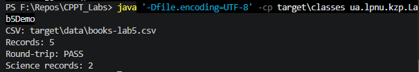
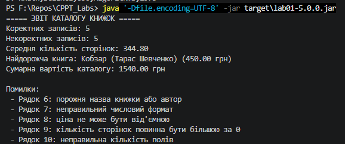
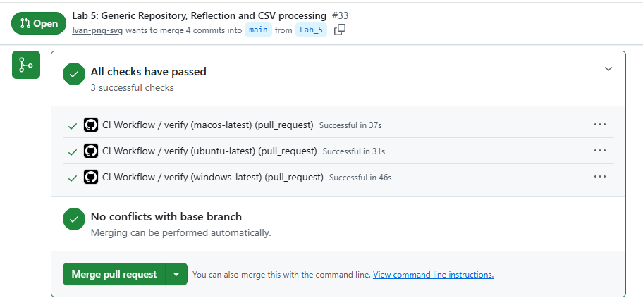

# ЗВІТ З ЛАБОРАТОРНОЇ РОБОТИ № 5

з дисципліни «Кросплатформні засоби програмування»

**Тема:** Узагальнення, анотації, рефлексія та робота з CSV у Java 21  
**Варіант:** 1 — «Бібліотека»  
**Виконав:** ст. гр. КІ-303 Андрус В.О.  
**Перевірив:** Олексів М.В.  
**Львів — 2026**

## 1. Мета роботи

Навчитися створювати узагальнені класи (`generics`), застосовувати функціональні інтерфейси, власні анотації та Java Reflection API; реалізувати універсальний CSV-експорт і предметний імпорт з коректною обробкою помилок, перевірити round-trip і зберегти сумісність попередніх лабораторних.

## 2. Середовище виконання

- Java 21; Maven / Maven Wrapper; JUnit 5; SpotBugs 4.8.6.6.
- Група Maven: `ua.lpnu.kzp`; артефакт: `lab01`; версія: `5.0.0`.
- Пакет Java: `ua.lpnu.kzp`.
- Гілка: `Lab_5`; цільовий `main`.
- Локальна перевірка: Windows PowerShell.

## 3. Постановка задачі (варіант 1)

Реалізувати модель книжкового запису з назвою, автором, роком видання, кількістю сторінок та жанром. Створити узагальнений репозиторій для додавання, перегляду та пошуку записів. Описати поля CSV власною анотацією; засобами рефлексії сформувати CSV з детермінованим порядком колонок. Забезпечити імпорт, екранування спеціальних символів, UTF-8, власний перевірюваний виняток, тести та перевірку round-trip. Не порушити роботу лабораторних №1–4.

## 4. Структура реалізації

| Файл | Призначення |
|---|---|
| `BookRecord.java` | Незмінна модель книжкового запису та перетворення CSV-полів |
| `Repository.java` | Узагальнене сховище `Repository<T>` |
| `CsvColumn.java` | Анотація полів, доступна під час виконання |
| `CsvExporter.java` | Рефлексивний CSV-експорт |
| `CsvParser.java` | Парсер CSV-документа |
| `BookRecordCsv.java` | Імпорт і перевірка записів предметної області |
| `DataStorageException.java` | Перевірюваний виняток з першопричиною |
| `Lab5Demo.java` | Демонстрація експорту, імпорту та пошуку |
| `Lab5Test.java` | Сім JUnit-тестів ЛР5 |

Модель `BookRecord` містить `title: String`, `author: String`, `year: int`, `pages: int`, `genre: BookGenre`. Наявний `BookGenre` повторно використовується з ЛР4.

## 5. Узагальнений репозиторій

`Repository<T>` не залежить від типу предметних даних. Метод `add(T)` додає елемент; `all()` повертає незмінний знімок колекції; `find(Predicate<? super T>)` повертає елементи, що задовольняють предикат. Це дозволяє виконувати пошук без дублювання коду для конкретного класу книжок.

## 6. Анотації та рефлексія

Анотація `@CsvColumn` має область застосування `FIELD` і час збереження `RUNTIME`. Експортер через Reflection API знаходить анотовані поля, враховує успадковані поля та впорядковує колонки за алфавітом Java-імен полів. Заголовки беруться зі значень анотацій.

Для `BookRecord` порядок Java-полів: `author`, `genre`, `pages`, `title`, `year`. Отже, заголовок CSV:

```csv
автор,жанр,сторінки,назва,рік
```

## 7. Формат CSV та зворотний імпорт

У ЛР5 застосовано CSV із комою як роздільником, подвійними лапками для складних полів і UTF-8. Коми, лапки та переноси рядків усередині тексту коректно екрануються. `CsvParser` розбирає документ як послідовність записів, а не як незалежні фізичні рядки, тому підтримує багаторядкові значення.

`BookRecordCsv.read(Path)` читає файл, перевіряє заголовок і перетворює рядки на `BookRecord`. Порожній набір даних з коректним заголовком підтримується. Некоректний заголовок, помилкова кількість полів і недопустимі значення призводять до контрольованого винятку.

**Сумісність:** старий `Main` продовжує використовувати формат `title;author;pages;price`, тому CSV ЛР5 не підмінює формат лабораторних №1–4.

## 8. Винятки та обробка помилок

Власний `DataStorageException` є перевірюваним (`checked`). Для помилок читання/запису файлу та вкладених помилок імпорту зберігається першопричина через `cause`. У `BookRecord.fromCsv(...)` після виправлення SpotBugs не перехоплюється `NullPointerException`; некоректні аргументи перевіряються явно.

## 9. Демонстрація `Lab5Demo`

Створюються п'ять книжок. Набір включає кому в назві, подвійні лапки та перенос рядка. Програма записує CSV до `target/data/books-lab5.csv`, зчитує його назад і порівнює початковий та відновлений списки. Додатково перевіряє пошук книжок жанру `SCIENCE`.

Команда запуску:

```powershell
java -cp target/classes ua.lpnu.kzp.Lab5Demo
```

**Фактично отриманий результат:**

```text
CSV: target\data\books-lab5.csv
Records: 5
Round-trip: PASS
Science records: 2
```

**Рисунок 1 — Демонстрація CSV round-trip.**  


*Скріншот потрібно додати до репозиторію перед завершенням звіту.*

## 10. Автоматизовані тести

`Lab5Test` містить 7 тестів:

1. Незмінний знімок репозиторію та фільтрація предикатом.
2. Анотації та порядок колонок у CSV.
3. Round-trip багаторядкового CSV зі спеціальними символами.
4. Порожній набір даних.
5. Некоректний CSV і збереження причини винятку.
6. Помилки файлових операцій і збереження `IOException`.
7. Універсальність експортера для іншого класу.

**Фактичний результат `clean verify`:**

```text
Tests run: 63, Failures: 0, Errors: 0, Skipped: 0
BUILD SUCCESS
```

Із 63 тестів 7 — тести ЛР5, 56 — тести попередніх лабораторних.

**Рисунок 2 — Результати JUnit-тестів.**  


*Скріншот потрібно додати.*

## 11. SpotBugs

Під час першого запуску SpotBugs виявив `DCN_NULLPOINTER_EXCEPTION` у `BookRecord.fromCsv(...)` через перехоплення `NullPointerException`. Перевірку аргументів змінено на явну, після чого повторна збірка пройшла успішно:

```text
BugInstance size is 0
Error size is 0
No errors/warnings found
BUILD SUCCESS
```

Це підтверджує відсутність невиключених попереджень SpotBugs за чинної конфігурації перевірки.

**Рисунок 3 — SpotBugs без помилок.**  


*Скріншот потрібно додати.*

## 12. Maven, JAR та зворотна сумісність

Версію `pom.xml` змінено з `4.0.0` на `5.0.0`. Збережено Java 21, JUnit, Maven Shade, SpotBugs і точку входу `ua.lpnu.kzp.Main`. Збірка створює `target/lab01-5.0.0.jar`.

```powershell
.\mvnw.cmd clean verify
java '-Dfile.encoding=UTF-8' -jar target\lab01-5.0.0.jar
java -cp target/classes ua.lpnu.kzp.Lab5Demo
```

До зміни версії запуск попереднього `Main` підтвердив: 5 коректних та 5 некоректних записів, середню кількість сторінок `344.80`, найдорожчу книжку «Кобзар» (`450.00 грн`) і загальну вартість `1540.00 грн`. Збірка версії `5.0.0` підтверджена; запуск нового JAR після зміни версії слід зафіксувати окремим скріншотом.

**Рисунок 4 — Зворотна сумісність і запуск JAR.**  


*Скріншот потрібно додати.*

## 13. GitHub Actions та артефакти

Наявний `.github/workflows/ci.yml` використовує матрицю `ubuntu-latest`, `windows-latest`, `macos-latest`, Temurin Java 21, Maven Wrapper, `verify` і `actions/upload-artifact@v4` для JAR-файлів. Workflow запускається на `push` до `main` і `pull_request` до `main`. Для перевірки гілки ЛР5 потрібно створити Pull Request `Lab_5` → `main`.

**Стан:** конфігурацію переглянуто; фактичний успіх трьох CI-завдань ЛР5 та доступність артефактів поки не підтверджені.

**Рисунок 5 — GitHub Actions на трьох ОС.**  


*Скріншот потрібно додати після успішного CI.*

## 14. GitHub Issues, Pull Request і Git-тег

Роботу ведено в гілці `Lab_5`. Підтверджені коміти:

- `f422355` — додано дев'ять Java-файлів ЛР5.
- `e5df452` — оновлено версію Maven до `5.0.0`.

GitHub Issues, Pull Request до `main`, злиття та тег `v5.0.0` необхідно оформити і підтвердити окремо. До цього їх не слід позначати як виконані.

**Рисунок 6 — Issues ЛР5.**  


**Рисунок 7 — Pull Request ЛР5.**  


**Рисунок 8 — Git-тег версії 5.0.0.**  


*Скріншоти додаються після відповідних дій на GitHub.*

## 15. Використання ШІ

ChatGPT використовувався як допоміжний інструмент для підготовки коду, тестових сценаріїв, аналізу Maven/SpotBugs та оформлення документації. Підтверджені результати наведено за фактичними журналами локального запуску. Статуси GitHub не підміняються припущеннями.

## 16. Таблиця помилок і перевірок

| Ситуація | Повідомлення / реакція | `cause` | Перевірка |
|---|---|---|---|
| Порожній CSV без заголовка | `CSV has no header` | Не обов’язкова для помилки структури | Негативний сценарій імпорту |
| Невірний заголовок | `Invalid CSV header` | Не обов’язкова | Перевірка заголовка |
| Неправильна кількість полів | `Expected 5 CSV fields` → `Invalid CSV record N` | Вкладений `DataStorageException` | `malformedCsvAndCause` |
| Невірне число, рік, сторінки чи enum | `Invalid BookRecord CSV value` → `Invalid CSV record N` | `IllegalArgumentException` у вкладеному винятку | `malformedCsvAndCause` |
| Незакриті лапки | Помилка синтаксису CSV | Залежить від рівня парсера | `malformedCsvAndCause` |
| Відсутній файл / неможливий запис | `Cannot read CSV` або помилка запису | `IOException` | `fileFailurePreservesIOException` |
| Недоступне поле чи відсутні анотації | Помилка рефлексивного експорту | Залежить від конкретного випадку | `genericExporterWorksForOtherClass` |

Повідомлення наведено за реалізацією, а не як універсальні повідомлення Java. Наявність `cause` перевіряється там, де є вихідний виняток; для помилок структури без вкладеної причини `cause` може бути `null`.

## 17. Повний приклад CSV та пояснення екранування

Заголовок визначається алфавітним порядком Java-полів, а не українських назв:

```csv
автор,жанр,сторінки,назва,рік
"Автор, Іван",SCIENCE,250,"Книга ""Про світ""",2024
```

Це **ілюстративний коректний приклад**, а не дослівна копія створеного `target/data/books-lab5.csv`. У ньому кома в авторі вимагає лапок, а внутрішні подвійні лапки в назві подвоюються. Поле з переносом рядка теж береться в лапки; один логічний CSV-запис може займати кілька фізичних рядків. Тому `split(",")` та розбір окремо кожного фізичного рядка не підходять.

Підтверджений демонстраційний результат: 5 відновлених об'єктів і `Round-trip: PASS`. **Фактичну кількість фізичних рядків CSV ще потрібно зафіксувати** зі створеного файлу; вона може перевищувати кількість логічних записів через переноси всередині полів.

## 18. Порівняння стану до та після ЛР5

До ЛР5 основний застосунок `Main` читав `title;author;pages;price`, виводив статистику й повідомлення про некоректні записи. Після ЛР5 з'явилися незалежна модель `BookRecord`, параметризоване сховище, анотація, універсальний експортер, парсер та імпортер. Попередній формат не замінювався. За локальним журналом усі 63 тести (56 попередніх і 7 нових) пройшли; контрольний вивід попереднього JAR відтворено. Побайтове порівняння старого й нового звітів окремо не підтверджено.

## 19. Контрольні питання: підготовка до захисту

**Примітка:** методичка ЛР5 вимагає відповіді на контрольні питання, але не містить окремого нумерованого переліку. Нижче — тематичні питання для підготовки, сформовані за її вимогами; їх не слід подавати як дослівні питання методички.

**1. Що означає `Repository<T>`?** Це узагальнений клас: `T` позначає тип елементів. Один і той самий репозиторій може зберігати різні типи без дублювання реалізації.

**2. Чому не варто використовувати raw types?** Вони прибирають перевірку типів на етапі компіляції та підвищують ризик помилок приведення типів.

**3. Для чого потрібен `Predicate<? super T>`?** Це умова відбору елементів, яка повертає `boolean`; запис `? super T` дозволяє використовувати предикат для `T` або його надтипу.

**4. Що означає незмінний знімок `all()`?** Користувач не може змінити повернений список, і пізніші додавання до репозиторію не змінюють раніше отриманий знімок.

**5. Навіщо потрібна анотація `@CsvColumn`?** Вона пов'язує поле Java з назвою CSV-колонки та дозволяє експортеру працювати з метаданими класу.

**6. Чим відрізняються `@Retention(RUNTIME)` і `@Target(FIELD)`?** Перше зберігає анотацію для читання під час виконання; друге дозволяє застосовувати її до полів.

**7. Що таке Reflection API?** Це засоби дослідження класів і полів під час виконання. Експортер знаходить поля з `@CsvColumn`, читає їхні значення та формує CSV.

**8. Чому порядок колонок детермінований?** Експортер сортує поля за Java-іменами, тому порядок не залежить від того, у якому порядку рефлексія повернула поля.

**9. Як екрануються коми й лапки в CSV?** Значення з комою, лапками або переносом береться в подвійні лапки; внутрішня лапка записується двічі.

**10. Чому `String.split(",")` недостатньо?** Кома може бути частиною значення в лапках, а переноси можуть бути всередині одного запису. Потрібен парсер із урахуванням стану лапок.

**11. Для чого явно вказувати UTF-8?** Щоб однаково зберігати й читати українські символи незалежно від ОС і системного кодування.

**12. Що таке round-trip?** Це цикл «об'єкти → CSV → об'єкти», після якого перевіряють рівність списків, їхній порядок та значення полів.

**13. Навіщо реалізовано `equals()` і `hashCode()`?** `equals()` забезпечує змістове порівняння відновлених об'єктів, а `hashCode()` узгоджується з ним для колекцій на основі хешування.

**14. Для чого власний `DataStorageException`?** Щоб явно повідомляти про помилки зберігання, читання та перетворення й передавати першопричину через `cause`.

**15. Чому важливо зберігати `cause`?** Це дає змогу відрізнити, наприклад, помилку числа від `IOException` і не втратити інформацію для діагностики.

**16. Чому `NullPointerException` не слід просто перехоплювати?** Краще явно перевірити недопустимі `null`-аргументи; це зрозуміліше й усуває зауваження SpotBugs.

**17. Як довести, що експортер універсальний?** Експортувати інший клас з анотованими полями без змін коду `CsvExporter`; такий сценарій є в `Lab5Test`.

**18. Що перевіряє `mvnw.cmd clean verify`?** Очищення збірки, компіляцію, JUnit, пакування JAR і перевірку SpotBugs згідно з `pom.xml`.

**19. Навіщо CI на трьох ОС?** Щоб перевірити збірку й тести в Ubuntu, Windows і macOS, зокрема поведінку шляхів та переносів рядків.

**20. Чим CSV ЛР5 відрізняється від попереднього CSV?** У ЛР5 п'ять полів, кома як роздільник і екранування; попередній `Main` використовує чотири поля з `;`. Обидва сценарії збережено окремо.

## 20. Що ще потрібно підтвердити перед здачею

- Створити GitHub Issues, указати їхні реальні номери й зв'язок зі змінами та тестами.
- Створити PR `Lab_5` → `main`, перевірити три зелені CI-завдання та завантаження JAR-артефактів.
- Зафіксувати Git-тег `v5.0.0` після завершення та перевірити відповідність версії.
- Додати в `docs/lab5/` справжні скріншоти, на які посилається звіт.
- Додати фактичний створений CSV або його фрагмент, число фізичних рядків, перевірку CRLF/LF і кодування.
- У розділі академічної доброчесності конкретизувати власні дії, прийняті й відхилені пропозиції та спосіб перевірки коду.

## 21. Висновки

У лабораторній №5 реалізовано узагальнений репозиторій, власну анотацію, рефлексивний CSV-експорт, імпорт, перевірку round-trip і контрольовану обробку помилок. Локальна перевірка версії `5.0.0` завершилася `BUILD SUCCESS`: 63 тести без помилок, SpotBugs — 0 невиключених попереджень. Демонстрація експорту/імпорту п'яти записів завершилася `Round-trip: PASS`. Збережено сумісність вихідного коду попередніх лабораторних. Для остаточної здачі залишилося оформити та перевірити GitHub Issues, PR, CI, тег і скріншоти.
