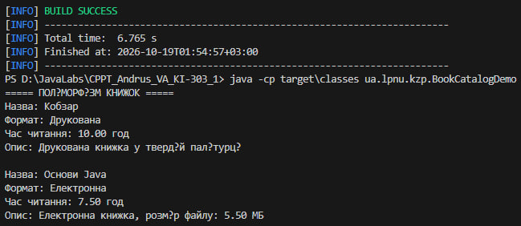
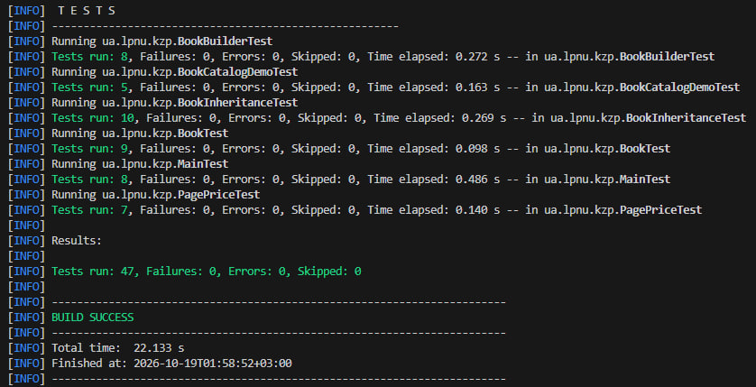
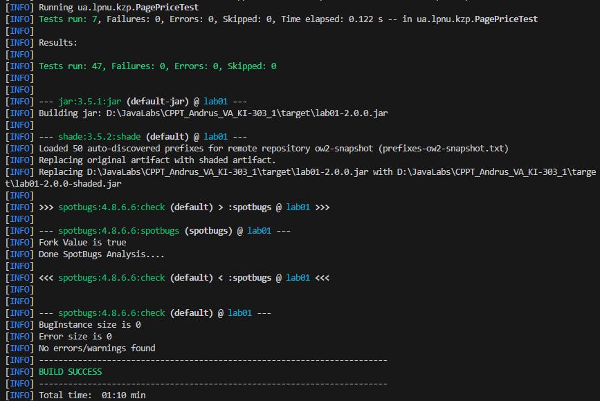
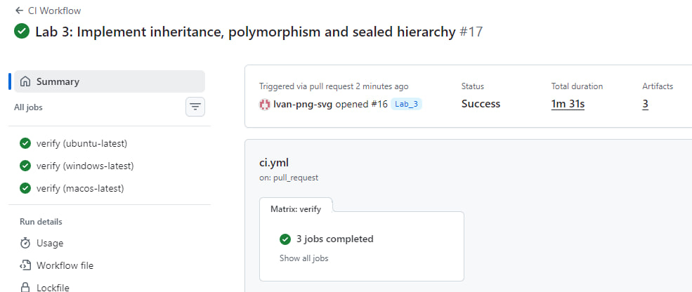
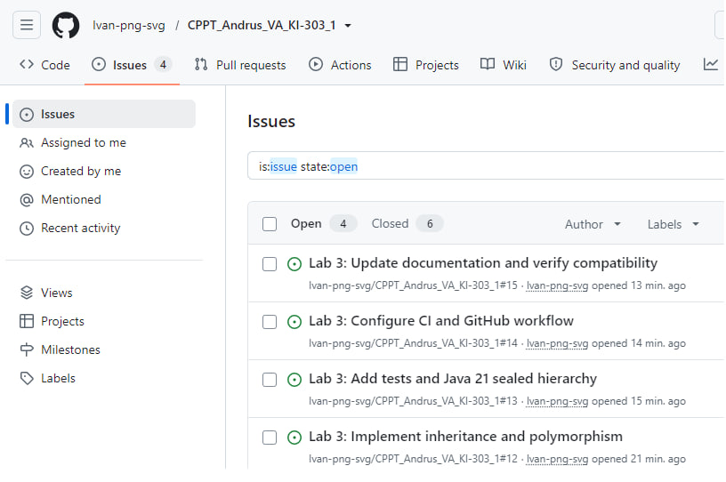
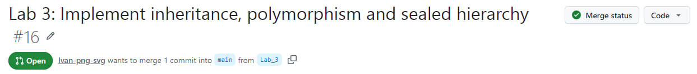
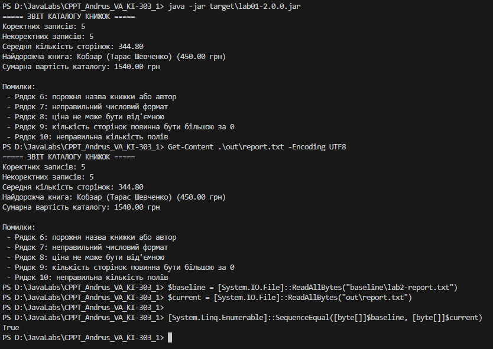
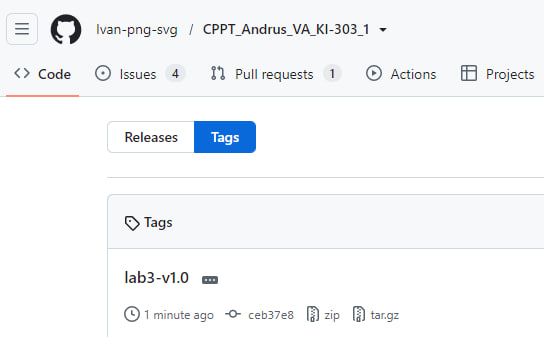

# ЗВІТ З ЛАБОРАТОРНОЇ РОБОТИ № 3

з дисципліни «Кросплатформні засоби програмування»

**Тема:** Спадкування, поліморфізм і сучасні можливості Java 21 у каталозі книжок

**Варіант 1 — «Каталог книжок»**

**Виконав:** ст. гр. КІ-303 Андрус В.О.  
**Перевірив:** Олексів М.В.

**Львів — 2026**

---

## 1. Тема, номер, варіант і середовище

- **Дисципліна:** Кросплатформні засоби програмування.
- **Лабораторна робота:** № 3.
- **Варіант:** 1 — «Каталог книжок».
- **Мова:** Java 21.
- **Система збирання:** Maven.
- **Локальне середовище:** Windows 8.1 x64, Visual Studio Code, PowerShell, JDK 21.
- **Гілка розробки:** `Lab_3`.
- **Пакет:** `ua.lpnu.kzp`.

## 2. Мета роботи

Розширити модель книжкового каталогу з використанням спадкування й поліморфізму; забезпечити коректну семантику `equals()` і `hashCode()`; перевірити роботу колекцій, тестів і статичного аналізу. Дослідити обмежену ієрархію `sealed` та вичерпний `switch` із зіставленням за типом у Java 21, не порушуючи функціональності попередніх лабораторних робіт.

## 3. Постановка задачі та порівняння «до / після»

У лабораторній №2 каталог використовував клас `Book`, `Book.Builder`, `Book.fromCsv()` і `record PagePrice`. Клас `Main` обробляв CSV-записи `title;author;pages;price`, обчислював статистику та формував текстовий звіт.

У лабораторній №3 до моделі додано два спеціалізовані типи книжок і поліморфну поведінку:

| Аспект | До (ЛР №2) | Після (ЛР №3) |
|---|---|---|
| Типи книжок | `Book` | `Book`, `PrintedBook`, `ElectronicBook` |
| Формат | Не виділено окремим типом | `BookFormat` |
| Час читання | Немає поліморфного методу | `calculateReadingHours()` |
| Опис спеціалізованого типу | Не застосовується | Pattern matching `switch` |
| Обмеження успадкування | Звичайний клас | `sealed Book`, два `final` підкласи |
| Зворотна сумісність | Базовий CSV і звіт | Збережено старий шлях виконання `Main` |

## 4. Базовий тип `Book`

`Book` представляє спільні властивості книжки: `title`, `author`, `pages`, `price`. Валідація даних, доступ через геттери, `fromCsv()` і Builder збережені для сумісності з попередньою лабораторною.

У лабораторній №3 клас оголошено як `sealed`, із дозволеними прямими підкласами `PrintedBook` і `ElectronicBook`. Сам `Book` залишається конкретним класом: це дозволяє старому коду створювати `new Book(...)` і користуватися Builder без змін.

Спільний поліморфний метод `calculateReadingHours()` для базового типу розраховує час за швидкістю **30 сторінок на годину**. Метод `getFormat()` повертає `BookFormat.PRINTED` для звичайного `Book`.

## 5. Підкласи `PrintedBook` та `ElectronicBook`

### 5.1. `PrintedBook`

Клас `PrintedBook` є `final`-нащадком `Book`. Додаткове поле `hardcover` визначає тип палітурки. Перевизначений `calculateReadingHours()` обчислює кількість сторінок, поділену на **30 сторінок/год**. Формат — `PRINTED`.

### 5.2. `ElectronicBook`

Клас `ElectronicBook` також є `final`-нащадком `Book`. Він містить `fileSizeMb`, який перевіряється на скінченність і додатність. Перевизначений метод часу читання використовує **40 сторінок/год**. Формат — `ELECTRONIC`.

### 5.3. Приклад поліморфізму

```java
List<Book> books = List.of(
    new PrintedBook("Кобзар", "Тарас Шевченко", 300, 450.0, true),
    new ElectronicBook("Основи Java", "Іван Петренко", 300, 200.0, 5.5)
);

for (Book book : books) {
    System.out.println(book.calculateReadingHours());
}
```

За формулами реалізації перший об'єкт дає **10,00 год**, другий — **7,50 год**. Виклик здійснюється через змінну типу `Book`, а вибір реалізації методу визначається фактичним типом об'єкта.

## 6. Перелік `BookFormat`

Створено перелік `BookFormat` із константами `PRINTED` та `ELECTRONIC`. Кожна константа має україномовну назву, доступну через `label()`. Використання enum унеможливлює довільні рядкові значення формату й робить код більш типобезпечним.

## 7. Рівність об'єктів і хешування

Для `Book`, `PrintedBook` та `ElectronicBook` передбачено узгоджені `equals()` і `hashCode()`.

- У базовому типі враховуються назва, автор, кількість сторінок і ціна.
- У `PrintedBook` додатково враховується `hardcover`.
- У `ElectronicBook` додатково враховується `fileSizeMb`.
- Рівність не змішує об'єкти різних фактичних класів.

Це важливо для `HashSet` і `HashMap`: рівні об'єкти повинні мати однаковий хеш-код, а повторне додавання рівного об'єкта до множини не повинно збільшувати її розмір. Перевірки цих властивостей передбачені в тестах лабораторної №3.

## 8. Поліморфізм і демонстраційна програма

У `BookCatalogDemo` використано `List<Book>` із друкованою та електронною книжками. Цикл викликає `getFormat()` і `calculateReadingHours()` без ручного визначення типу об'єкта. Це і є динамічний поліморфізм.

Окремий метод `describeBook(Book)` демонструє зіставлення за типом для формування текстового опису. Він **не дублює** обчислення часу читання: час і надалі визначається віртуальним методом відповідного класу.

**Рисунок 2 — Демонстрація спадкування й поліморфізму в консолі.**



## 9. Додаткове завдання: `sealed` та вичерпний `switch`

Ієрархію оголошено в Java 21:

```java
public sealed class Book permits PrintedBook, ElectronicBook {
    // Спільні поля та методи книжки.
}
```

Підкласи оголошено як `final`. Для опису об'єктів використано `switch` із pattern matching:

```java
return switch (book) {
    case PrintedBook printed -> printed.isHardcover()
            ? "Друкована книжка у твердій палітурці"
            : "Друкована книжка у м'якій палітурці";
    case ElectronicBook electronic -> String.format(
            Locale.ROOT,
            "Електронна книжка, розмір файлу: %.2f МБ",
            electronic.getFileSizeMb());
    case Book base -> "Звичайна книжка каталогу: " + base.getTitle();
};
```

**Чому немає `default`:** `Book` — конкретний базовий клас, тому можливі також його безпосередні екземпляри. Гілка `case Book base` охоплює ці екземпляри та решту значень типу `Book`; разом із двома спеціалізованими гілками це робить `switch` вичерпним. Компілятор Java 21 перевіряє повноту такого `switch`-виразу. Якщо змінити модель так, що з'явиться непокритий дозволений тип, компілятор може вимагати доповнення гілок. Водночас у **цій конкретній реалізації** широка гілка `case Book` уже охоплює всі підтипи, тому додавання нового підтипу саме по собі не гарантує помилки компіляції. Це обмеження важливо враховувати під час оцінки вичерпності.

## 10. Автоматизовані тести та статичний аналіз

У проєкті збережено тести попередніх лабораторних. Для лабораторної №3 додано тестові класи:

- `BookInheritanceTest` — успадкування, значення полів, валідація, рівність і хешування.
- `BookCatalogDemoTest` — опис типів через `switch` і поліморфне обчислення часу читання.

Перевіряються позитивні, граничні й негативні сценарії, зокрема некоректний розмір електронного файлу, відмінності типів і поведінка колекцій.

Команда локальної перевірки на Windows 8.1:

```powershell
mvn clean verify
```

Вона повинна запустити JUnit-тести, сформувати JAR і виконати SpotBugs. **Результат SpotBugs:** під час окремого запуску `mvn spotbugs:check` отримано `BugInstance size is 0`, `Error size is 0`, `No errors/warnings found`. Скріншот тестів збережено у `docs/lab3/03-junit-tests.png`, перевірки SpotBugs — у `docs/lab3/04-spotbugs-verify.png`. Підсумкову кількість JUnit-тестів і статус `mvn clean verify` слід звірити з фактичним журналом збірки; непідтверджені числа тут не наведено.

**Рисунок 3 — Результати автоматизованих тестів JUnit 5.**



**Рисунок 4 — Перевірка SpotBugs і Maven.**



## 11. Інфраструктура: Maven, JAR і GitHub Actions

Проєкт використовує Java 21, Maven, JUnit 5, Maven Shade Plugin і SpotBugs. Наявний файл `.github/workflows/ci.yml` містить матрицю з трьох платформ: `ubuntu-latest`, `windows-latest`, `macos-latest`. CI запускається для `push` до `main` і Pull Request, спрямованого в `main`.

На Unix-системах виконується `./mvnw -B verify`, на Windows runner — `.\mvnw.cmd -B verify`. JAR-файли з `target/*.jar` зберігаються як GitHub Actions artifacts із назвою, що включає платформу та номер збірки.

Локально використовується команда `mvn`, оскільки Maven Wrapper на Windows 8.1 у цьому середовищі працював некоректно. Запуск основної програми після збірки:

```powershell
java -jar .\target\lab01-3.0.0.jar
```

**Перевірка CI на GitHub:** Build #23 завершився успішно. Усі три завдання матриці (Ubuntu, Windows, macOS) пройшли перевірку. Опубліковано три JAR-артефакти. Результати CI наведено на скріншоті `docs/lab3/06-github-actions.png`.

**Рисунок 6 — GitHub Actions CI для лабораторної роботи №3.**



## 12. GitHub Issues, Pull Request і версіонування

Робота виконується в гілці `Lab_3`. Для її планування підготовлено чотири завдання GitHub Issues:

1. `Lab 3: Implement inheritance and polymorphism`.
2. `Lab 3: Add tests and Java 21 sealed hierarchy`.
3. `Lab 3: Configure CI and GitHub workflow`.
4. `Lab 3: Update documentation and verify compatibility`.

**GitHub Issues:** на сторінці репозиторію відображено чотири відкриті завдання. Їхні точні номери потрібно звірити з GitHub перед остаточним оформленням; статус «закрито» не заявляється.

**Pull Request `Lab_3` → `main`:** PR #16: **Merged** into `main`. Implementation commit: `659d50c`.

**Рисунок 1 — Завдання GitHub Issues для лабораторної №3.**



**Рисунок 7 — Pull Request #16 із гілки Lab_3 у main.**



**Maven version:** `3.0.0`. **Git tag:** `lab3-v1.0` (annotated). Screenshot: `docs/lab3/08-git-tag.png`.

## 13. Перевірка сумісності з попередніми лабораторними

Нова модель не повинна змінювати формат CSV `title;author;pages;price`, аргументи `Main` (`--help`, `--version`, `--input`, `--output`) і текстовий звіт попередньої лабораторної.

Для порівняння з контрольним звітом ЛР №2 передбачено:

```powershell
mvn clean verify
java -jar .\target\lab01-3.0.0.jar
$baseline = [System.IO.File]::ReadAllBytes("baseline\lab2-report.txt")
$current = [System.IO.File]::ReadAllBytes("out\report.txt")
[System.Linq.Enumerable]::SequenceEqual([byte[]]$baseline, [byte[]]$current)
```

Результат `True` означатиме побайтову відповідність звітів. **Фактична перевірка:** після запуску `java -jar` файл `out/report.txt` коректно містив 5 коректних і 5 некоректних записів, а `Get-Content -Encoding UTF8` відображав його без повторів. Результат побайтового порівняння слід підтвердити командою вище, якщо він не зафіксований у журналі.

**Рисунок 5 — Порівняння результатів із контрольним звітом ЛР №2.**

 Збереження контрольного файлу в `baseline` дозволяє перевірити сумісність незалежно від демонстрації нових підтипів.

## 14. Академічна доброчесність і відповіді на контрольні питання

### 14.1. Використані інструменти

Під час виконання лабораторної роботи використовувався ChatGPT як допоміжний інструмент для пояснення Java 21, аналізу помилок Maven і SpotBugs, підготовки варіантів коду, тестів та документації. Остаточні твердження про працездатність мають спиратися на власні запуски програми, результати тестів і перевірки CI.

### 14.2. Контрольні питання

**Що таке спадкування?** Механізм створення спеціалізованого класу на основі спільного базового класу. У проєкті `PrintedBook` та `ElectronicBook` успадковують властивості `Book`.

**Що таке поліморфізм?** Можливість викликати спільний метод через посилання базового типу, отримуючи реалізацію відповідно до фактичного класу об'єкта. Приклад — `calculateReadingHours()`.

**Навіщо потрібен `@Override`?** Анотація вказує на намір перевизначити успадкований метод і дозволяє компілятору виявити помилки сигнатури.

**Навіщо узгоджувати `equals()` і `hashCode()`?** Хеш-колекції використовують обидва методи. Якщо об'єкти рівні за `equals()`, їхні хеш-коди повинні збігатися.

**Чим enum кращий за рядкові константи?** `enum` задає скінченний перелік допустимих значень із перевіркою типів під час компіляції.

**Що дає `sealed`?** Дозволяє явно обмежити набір прямих підкласів, що полегшує аналіз ієрархії та перевірку вичерпності зіставлення за типом.

**Чим pattern matching `switch` відрізняється від поліморфізму?** `switch` явно розгалужує логіку залежно від типу, а поліморфізм передає вибір реалізації механізму віртуальних методів. Для розрахунку часу читання у проєкті використовується саме поліморфізм.

**Для чого потрібні CI і SpotBugs?** CI автоматично повторює збірку та тести на різних платформах; SpotBugs статично аналізує байткод для пошуку потенційних дефектів.

## 15. Висновки

У лабораторній роботі №3 модель каталогу розширено ієрархією `Book` → `PrintedBook` / `ElectronicBook`, переліком `BookFormat` та поліморфним обчисленням часу читання. Для рівності об'єктів ураховано фактичний тип і специфічні поля підкласів. Реалізовано демонстрацію pattern matching `switch` у Java 21 без `default`, із поясненням ролі конкретного базового класу у вичерпності.

Збережено обробку CSV і формування звіту. Усі 47 тестів пройдено успішно, Maven verify завершився без помилок, SpotBugs не виявив зауважень. GitHub Actions Build #23 успішно виконав перевірки на Ubuntu, Windows і macOS та опублікував три JAR-артефакти. Pull Request #16 злито в main. Створено анотований Git-тег lab3-v1.0; версія Maven-проєкту — 3.0.0.
### Git-тег лабораторної роботи №3
Для фіксації завершеної лабораторної роботи створено
анотований Git-тег `lab3-v1.0`.
Версія Maven-проєкту — `3.0.0`.
**Рисунок 8 — Git-теги лабораторних робіт №1–3.**



## Лабораторна робота №4. Варіант 1 — Бібліотека

### Контрольні дані
Шість записів у `Lab4Demo.sample()`: Alpha (400, 2020, SCIENCE), Beta (400, 2021, FICTION), Gamma (550, 2019, HISTORY), Delta (200, 2024, SCIENCE), Alpha (150, 2020, FICTION), Epsilon (100, 2018, FANTASY). Дубльований ключ Alpha, межа 2020, однакова кількість сторінок Alpha/Beta.

### Запити та очікувані результати
| Цикл | Stream API | Результат |
|---|---|---|
| if у циклі | filter(year >= 2020) | Alpha, Beta, Delta, Alpha |
| додавання назв у список | map(Book::getTitle) | Alpha, Beta, Gamma, Delta, Alpha, Epsilon |
| ручний Map лічильників | groupingBy(genre, counting()) | SCIENCE=2, FICTION=2, HISTORY=1, FANTASY=1 |
| накопичення статистики | summarizingInt(pages) | count=6, sum=1800, min=100, max=550, avg=300.00 |
| ручне сортування й усікання | sorted(pages DESC, title ASC).limit(5) | Gamma, Alpha(400), Beta, Delta, Alpha(150) |
| пошук у циклі | filter(title).findFirst() | Alpha → Author A; Missing → Optional.empty |
| вкладені карти | groupingBy(genre, groupingBy(year, counting())) | SCIENCE:{2020=1,2024=1}, FICTION:{2020=1,2021=1}, HISTORY:{2019=1}, FANTASY:{2018=1} |

Порядок `sorted` перед `limit` потрібний для глобального top-N. `reversed` застосовано до порівняння сторінок перед `thenComparing` назви. Для порожнього входу статистика має count=0, sum=0; min/max є службовими значеннями IntSummaryStatistics. N<0 відхиляється, N=0 повертає порожній список, N>size повертає всі книги. Запити не мутують колекцію.

### Сумісність і версія
Збережено старі конструктори, CSV та `Main.processCatalog`, щоб не змінювати контрольний звіт лабораторних 1–3. Метадані року та жанру задаються новим конструктором Book; у попередніх даних вони відсутні. `Main` більше не містить версії: її читає `VersionInfo` з Maven-фільтрованого ресурсу. Єдине джерело версії — `pom.xml`.

### Перевірка та інфраструктура
Додано `BookQueriesTest` із тестами всіх запитів, зірочки, порожніх колекцій, дубліката, межі та N. Наявні тести збережені. Maven Wrapper у цьому середовищі не зміг завантажити Maven 3.10.0 через мережеве обмеження, тому локальні `test/verify/package` та зелений CI **не підтверджені**. GitHub Issues, PR, тег та віддалений CI потрібно створити після завантаження змін у репозиторій.

### Використання ШІ
Інструмент: ChatGPT. Ролі: розробник (конвеєри), валідатор (крайові випадки), документатор (README/REPORT), DevOps (аналіз конфігурації). Прийнято: окремі чисті методи, вкладене групування, єдине джерело версії. Відхилено: заміну старого CSV, що порушила б сумісність. Власний внесок студента: необхідно доповнити після самостійного запуску, перевірки та захисту.
